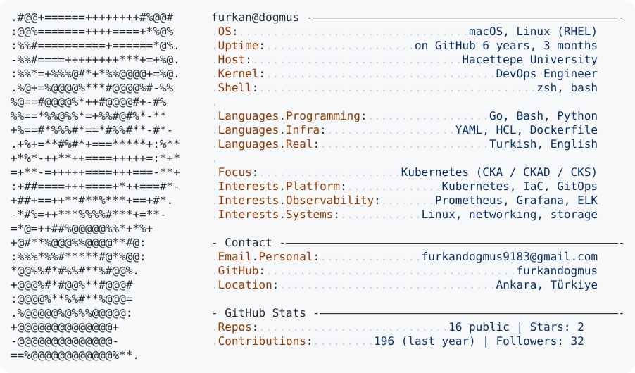

<a href="https://github.com/furkandogmus">
  <picture>
    <source media="(prefers-color-scheme: dark)" srcset="https://raw.githubusercontent.com/furkandogmus/furkandogmus/main/dark_mode.svg">
    
  </picture>
</a>
<a href="https://certdirectory.io/profile/furkan-dogmus?utm_source=github&utm_medium=readme">
  <picture>
    <source media="(prefers-color-scheme: dark)" srcset="https://certdirectory.io/badge/furkan-dogmus.svg?style=card&theme=dark">
    
  </picture>
</a>
